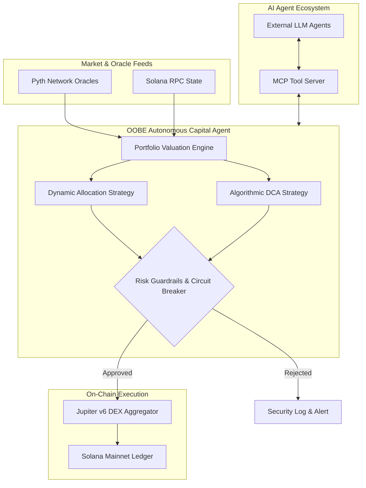

# ⚡ OOBE Protocol: Autonomous Capital Agent on Solana

[](https://www.typescriptlang.org/)
[](https://solana.com/)
[](https://jup.ag/)
[](https://pyth.network/)
[](https://modelcontextprotocol.io/)
[](https://opensource.org/licenses/MIT)

> **Autonomous on-chain capital allocation, risk-guarded portfolio rebalancing, and execution agent built for the OOBE Protocol ecosystem on Solana.**

---

## 🎯 Overview

The **OOBE Autonomous Capital Agent** is a production-ready, self-governing on-chain agent designed to manage, protect, and optimize decentralized treasury capital on Solana. 

Operating under programmable **OOBE Protocol risk guardrails**, the agent autonomously monitors asset weights (e.g. 50% SOL, 30% USDC, 20% JitoSOL), pulls ultra-low-latency price feeds from **Pyth Network oracles**, dynamically routes rebalancing swaps through the **Jupiter DEX Aggregator**, and exposes a standardized **Model Context Protocol (MCP)** server so external AI agents (Claude, Gemini, Cursor, custom agents) can safely interact with on-chain capital.

---

## 🏗️ Architecture



---

## 🛡️ Key Features & Guardrails

1. **Autonomous Rebalance Engine**:
   - Calculates real-time portfolio allocation deviations against configurable target weights.
   - Triggers surgical compensatory swap orders when deviations exceed threshold (e.g. $\pm 3\%$).

2. **Deterministic Risk Guardrails**:
   - **Max Trade Size Limit**: Rejects individual allocations above pre-set USD bounds (e.g. \$2,500).
   - **Daily Volume Cap**: Enforces cumulative 24-hour volume limits (e.g. \$10,000) with UTC daily reset.
   - **Max Slippage Protection**: Restricts execution to tightly bounded slippage tolerance ($\le 1.5\%$).
   - **Emergency Circuit Breaker**: Instant one-call freeze across all autonomous capital actions.
   - **Security Blacklist**: Prohibits toxic or unverified SPL token mints.

3. **Jupiter v6 DEX Integration**:
   - Queries multi-hop routes across Orca Whirlpools, Raydium CPMM, and Meteora DLMM for minimal price impact.

4. **Model Context Protocol (MCP) Server**:
   - Exposes standardized JSON-RPC tools (`get_portfolio_state`, `run_rebalance_check`, `get_risk_guardrails`, `trigger_emergency_circuit_breaker`).

5. **Interactive Real-Time Dashboard**:
   - Live visual analytics dashboard with real-time portfolio distribution, simulated market shock triggers, and execution feeds.

---

## 🚀 Quickstart

### Prerequisites
- Node.js v18+ (tested on v20+)
- npm or pnpm

### Installation
```bash
git clone https://github.com/juandiegohernandezangarita13-png/solana-autonomous-capital-agent.git
cd solana-autonomous-capital-agent
npm install
```

### Running the Agent CLI
```bash
# Run autonomous evaluation cycle
npm start
```

### Running the Test Suite
```bash
npm test
```

### Running the MCP Server
```bash
npm run mcp
```

### Interactive Web Dashboard
Open `public/index.html` in any modern web browser or serve it with:
```bash
npx serve public
```

---

## 🛠️ MCP Tool Definitions

| Tool Name | Parameters | Description |
| :--- | :--- | :--- |
| `get_portfolio_state` | `{}` | Returns current Solana token balances, Pyth valuations, and target weights. |
| `run_rebalance_check` | `{}` | Runs evaluation cycle and executes Jupiter DEX swaps if allocation skews exceed threshold. |
| `get_risk_guardrails` | `{}` | Returns active safety limits, daily volume used, and circuit breaker status. |
| `trigger_emergency_circuit_breaker` | `{"reason": string}` | Activates emergency halt, immediately freezing all autonomous swaps. |

---

## 🧪 Verification & Testing

The repository includes a comprehensive test suite in `test/agent.test.ts` covering:
- Mathematical accuracy of portfolio valuations under Pyth oracle prices.
- Rejection of oversized trades violating `maxTradeSizeUsd`.
- Circuit breaker trip behavior halting execution pipelines.
- Rebalance order generation under synthetic market skews (+15% SOL rally).
- MCP tool dispatch and JSON-RPC schema compliance.

---

## 👤 Author & Settlement

* **Developer:** Juan Diego Hernandez ([@juandiegohernandezangarita13-png](https://github.com/juandiegohernandezangarita13-png))
* **Superteam Profile:** `@Diegoh_21`
* **Settlement Wallet (EVM / Base / USDC):** `0xc49a22a14b02189c5fd640809c5800ca5168be9e`
* **License:** MIT
